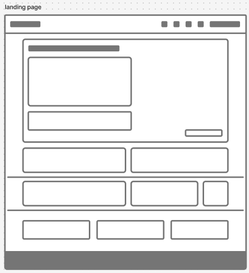
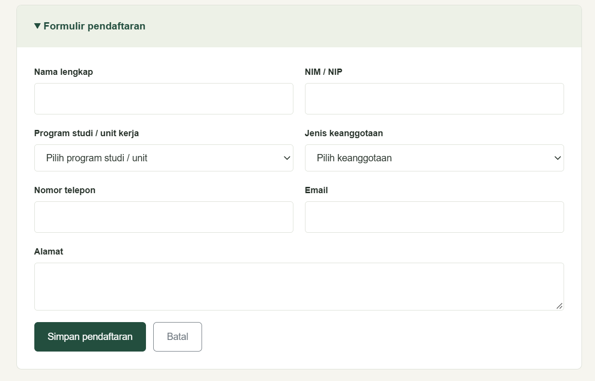
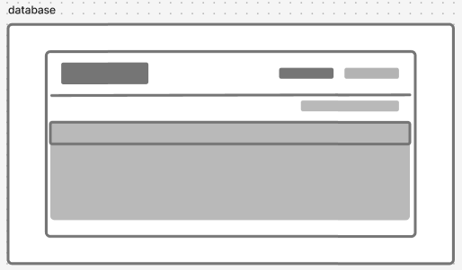
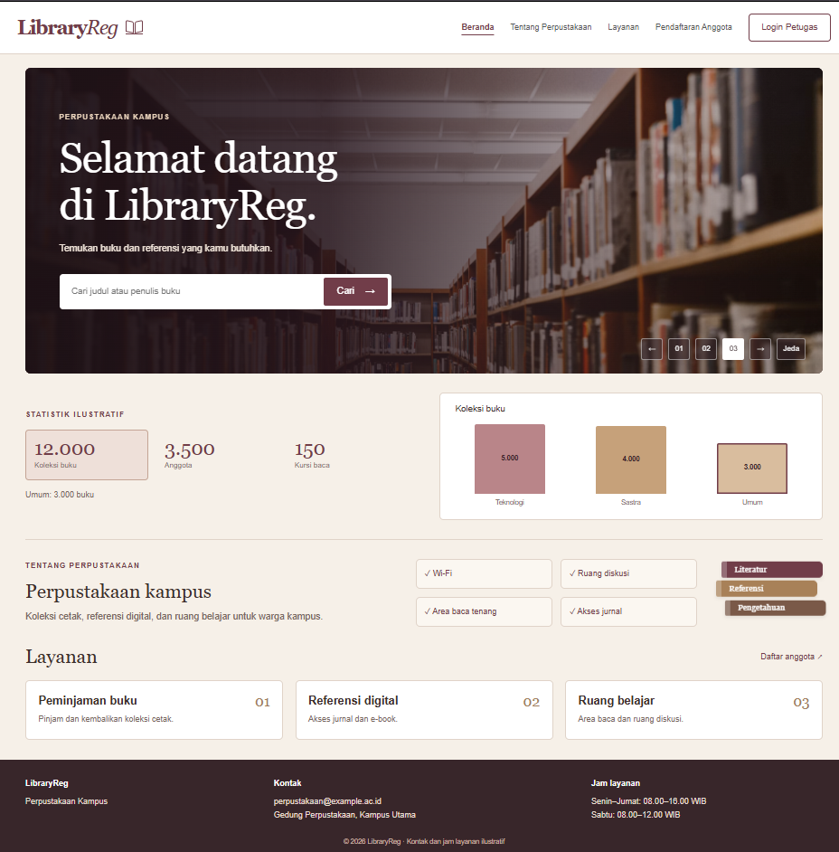
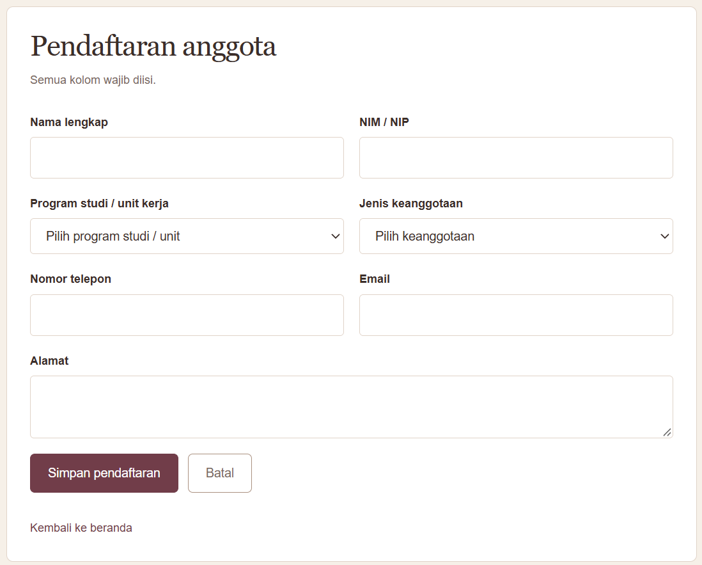
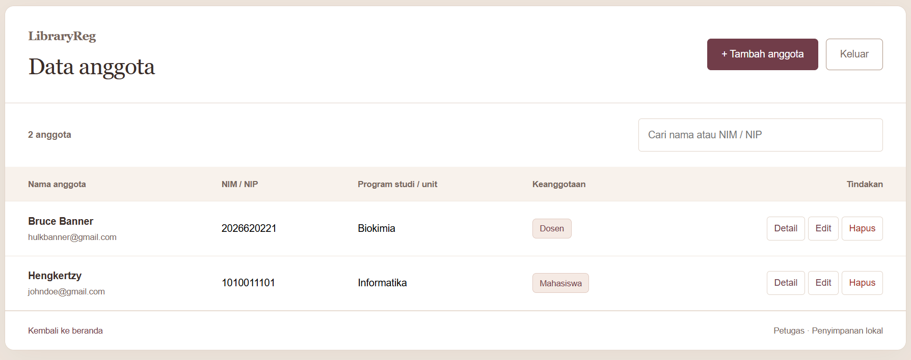

# ETS — LibraryReg

**Nama:** Khalisya Zahra Putria Rahman  

**NRP:** 5025251045

**Kelas:** Pemrograman Web B

## 1. Deskripsi dan Ruang Lingkup Pekerjaan

### Deskripsi sistem

LibraryReg adalah aplikasi web pendaftaran anggota perpustakaan kampus. Pengunjung dapat melihat informasi perpustakaan dan mengisi formulir keanggotaan. Petugas dapat mencari, melihat, mengedit, dan menghapus data anggota melalui halaman admin.

### Latar belakang

Pendaftaran dengan formulir kertas menyebabkan antrean, kesalahan pencatatan, pencarian data yang sulit, dan keterlambatan pembuatan kartu anggota. LibraryReg menangani bagian pendaftaran dan pengelolaan datanya melalui web.

### Tujuan

- Memindahkan pengisian formulir dari kertas ke halaman web.
- Mengurangi data kosong, format yang salah, dan nomor induk ganda.
- Memudahkan petugas mencari dan memperbarui data anggota.
- Menyediakan informasi layanan dalam halaman yang dapat diakses melalui komputer maupun ponsel.

### Analisis kebutuhan pengguna

| Pengguna | Kebutuhan | Solusi dalam aplikasi |
| --- | --- | --- |
| Pengunjung | Mengetahui layanan, fasilitas, kontak, dan jam buka | Landing page informatif |
| Calon anggota: mahasiswa, dosen, dan tenaga kependidikan | Mendaftar tanpa mengisi formulir kertas | Formulir online dengan validasi |
| Calon anggota dengan prodi yang belum tersedia | Mengisi program studi atau unit kerja sendiri | Pilihan Lainnya membuka textbox |
| Petugas perpustakaan | Menemukan data berdasarkan nama atau nomor induk | Pencarian pada tabel anggota |
| Petugas perpustakaan | Memeriksa, memperbaiki, atau menghapus data | Detail anggota, edit, dan konfirmasi hapus |

### Ruang lingkup dan kebutuhan fungsional

| Bagian | Pekerjaan yang dibuat |
| --- | --- |
| Landing page | Logo, carousel tiga foto, informasi perpustakaan, layanan, fasilitas, kontak, dan jam layanan |
| Navigasi | Navbar Bootstrap responsif, tautan antarbagian dan halaman, serta penanda menu aktif |
| Pencarian buku | Pencarian judul atau penulis dari katalog contoh di JavaScript |
| Statistik | Angka ilustratif dan grafik yang dapat dipilih berdasarkan koleksi, anggota, atau kursi baca |
| Pendaftaran | Formulir anggota pada halaman terpisah, selalu terbuka dan berada di tengah |
| Validasi | Kolom wajib, format email dan telepon, NIM/NIP berupa angka dan tidak boleh sama antaranggota |
| Login petugas | Dialog login simulasi untuk mengakses halaman admin |
| Pengelolaan anggota | Tabel anggota, pencarian, detail, edit, dan hapus dengan konfirmasi |
| Notifikasi | Pesan keberhasilan atau kesalahan saat menyimpan dan mengelola data |
| Penyimpanan | Data anggota di localStorage agar tetap tersedia setelah halaman dimuat ulang |

Data pada formulir:

| Kolom | Ketentuan |
| --- | --- |
| Nama lengkap | Wajib diisi |
| NIM/NIP | Wajib, hanya angka, dan unik |
| Program studi / unit kerja | Wajib; dropdown dengan isian manual untuk pilihan Lainnya |
| Alamat | Wajib diisi |
| Nomor telepon | Wajib; 8–15 angka dan boleh diawali tanda + |
| Email | Wajib menggunakan format email yang valid |
| Jenis keanggotaan | Wajib memilih mahasiswa, dosen, atau tenaga kependidikan |

### Kebutuhan nonfungsional

- Tata letak menyesuaikan layar komputer dan ponsel.
- Font, warna, dan bentuk tombol konsisten antarhalaman.
- Input memiliki label dan pesan validasi yang jelas.
- Tabel dapat digeser mendatar pada layar kecil.
- Animasi mengikuti pengaturan pengurangan gerakan pada perangkat.
- Data anggota tetap tersedia pada browser dan perangkat yang sama setelah reload.

### Kriteria keberhasilan

- Pendaftaran yang valid tersimpan dan dapat dilihat petugas pada tabel.
- Formulir menolak kolom kosong, email tidak valid, serta NIM/NIP nonangka atau duplikat.
- Data prodi manual tersimpan dan dapat diedit kembali.
- Pengunjung yang belum login diarahkan ke login saat membuka halaman admin.
- Petugas dapat mencari, melihat detail, mengedit, serta menghapus anggota setelah konfirmasi.
- Data anggota tetap ada setelah halaman dimuat ulang.

## 2. Rancangan Halaman dan Struktur Menu

### Pembagian halaman

| Halaman | File | Rancangan |
| --- | --- | --- |
| Landing page | [index.html](index.html) | Navbar, hero carousel dengan pencarian buku, hasil pencarian, statistik interaktif, tentang perpustakaan, fasilitas, layanan, dan footer |
| Pendaftaran | [form.html](form.html) | Satu kotak di tengah berisi judul, formulir, pesan validasi, tombol simpan dan batal, serta tautan kembali |
| Pengelolaan anggota | [admin.html](admin.html) | Satu panel berisi judul data anggota, tombol tambah dan keluar, pencarian, tabel, dan tautan kembali |
| Login petugas | Dialog pada landing page | Username, kata sandi, pesan kesalahan, tombol masuk dan batal |
| Detail anggota | Dialog pada halaman admin | Seluruh data anggota dan tombol tutup |

### Struktur menu

| Menu | Tujuan | Akses |
| --- | --- | --- |
| Beranda | Bagian hero pada index.html | Semua pengunjung |
| Tentang Perpustakaan | Bagian tentang dan fasilitas pada index.html | Semua pengunjung |
| Layanan | Bagian layanan pada index.html | Semua pengunjung |
| Pendaftaran Anggota | form.html | Semua pengunjung |
| Login Petugas | Dialog login pada index.html | Semua pengunjung |
| Daftar Anggota | admin.html | Petugas setelah login |
| Tambah anggota | form.html | Dari halaman admin |
| Detail, Edit, Hapus | Data anggota yang dipilih | Petugas |
| Keluar | Mengakhiri sesi simulasi dan kembali ke beranda | Petugas |

### Alur penggunaan

**Pendaftaran:** buka formulir → lengkapi data → validasi → simpan ke localStorage → tampilkan notifikasi.

**Pengelolaan:** login petugas → buka panel anggota → cari atau pilih anggota → lihat detail, edit, atau hapus.

**Edit:** pilih Edit → buka formulir berisi data anggota → simpan perubahan → kembali ke panel anggota.

**Hapus:** pilih Hapus → konfirmasi → hapus data → perbarui tabel.

**Pencarian buku:** masukkan judul atau penulis → pilih Cari → tampilkan hasil dari katalog contoh.

## 3. Desain UI Landing Page

### Rancangan visual

| Elemen | Desain |
| --- | --- |
| Warna utama | Burgundy #713D49 |
| Warna pendukung | Cokelat, krem #F6F0E8, dan putih |
| Font | Georgia untuk judul dan logo; Arial untuk teks, formulir, dan kontrol |
| Header | Logo di kiri, menu navigasi dan login petugas di kanan |
| Hero | Carousel tiga foto sebagai background; sisi kiri digelapkan untuk judul dan search bar |
| Statistik | Pilihan kategori dan grafik batang interaktif |
| Tentang dan fasilitas | Deskripsi singkat, kotak kecil untuk tiap fasilitas, dan ilustrasi buku |
| Layanan | Tiga kotak untuk peminjaman buku, referensi digital, dan ruang belajar |
| Footer | Nama perpustakaan, kontak, dan jam layanan |

Urutan landing page: **header → hero dan pencarian → hasil pencarian jika ada → statistik → tentang dan fasilitas → layanan → footer**.

### Desain Figma

**Tautan Figma:** https://www.figma.com/board/138r2ZT6IwafNFqhCOS8Rr/ETS-PWEB-LIBRARYREG-WIREFRAME?node-id=0-1&t=kTjbK98sX6KFXq2S-1.

### Dokumentasi Wireframe

**Landing page**

**Formulir pendaftaran**

**Database anggota**

## 4. Implementasi & Deploy

### File

| File | Fungsi |
| --- | --- |
| [index.html](index.html) | Struktur landing page: navigasi, carousel, pencarian buku, statistik, informasi perpustakaan, layanan, dan dialog login petugas. |
| [form.html](form.html) | Formulir pendaftaran dan edit anggota, termasuk pilihan program studi serta isian manual untuk pilihan Lainnya. |
| [admin.html](admin.html) | Panel petugas untuk mencari anggota, melihat detail, mengedit, dan menghapus data. |
| [style.css](style.css) | Warna, font, tata letak, tampilan responsif, dan animasi pada seluruh halaman. |
| [script.js](script.js) | Validasi formulir, pencarian buku dan anggota, login simulasi, grafik interaktif, serta penyimpanan dan pengelolaan data anggota. |

### Publish

| Halaman | Tautan |
| --- | --- |
| Landing page | [Buka LibraryReg](https://libraryreg-pweb.vercel.app/) |
| Formulir pendaftaran | [Buka formulir](https://libraryreg-pweb.vercel.app/form.html) |
| Panel petugas | [Buka panel anggota](https://libraryreg-pweb.vercel.app/admin.html) |

### Akun petugas simulasi

| Username | Kata sandi |
| --- | --- |
| petugas | library123 |

### Dokumentasi Website

**Landing page**

**Formulir pendaftaran**

**Database anggota**

