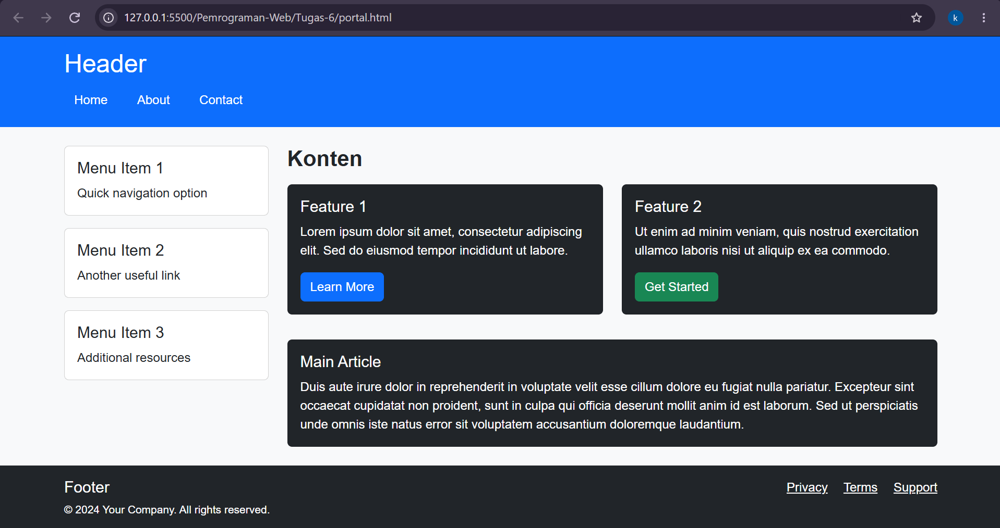
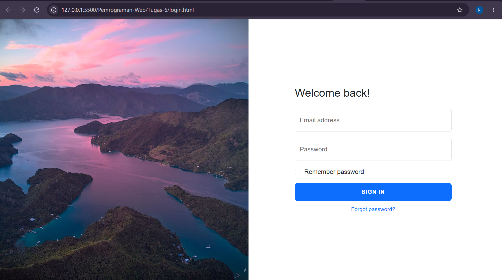
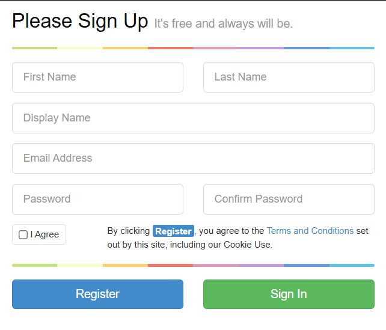
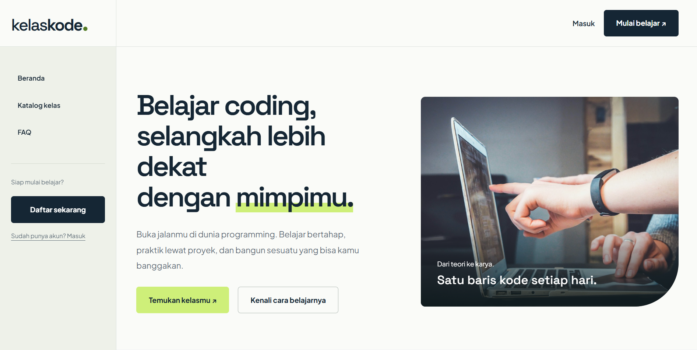
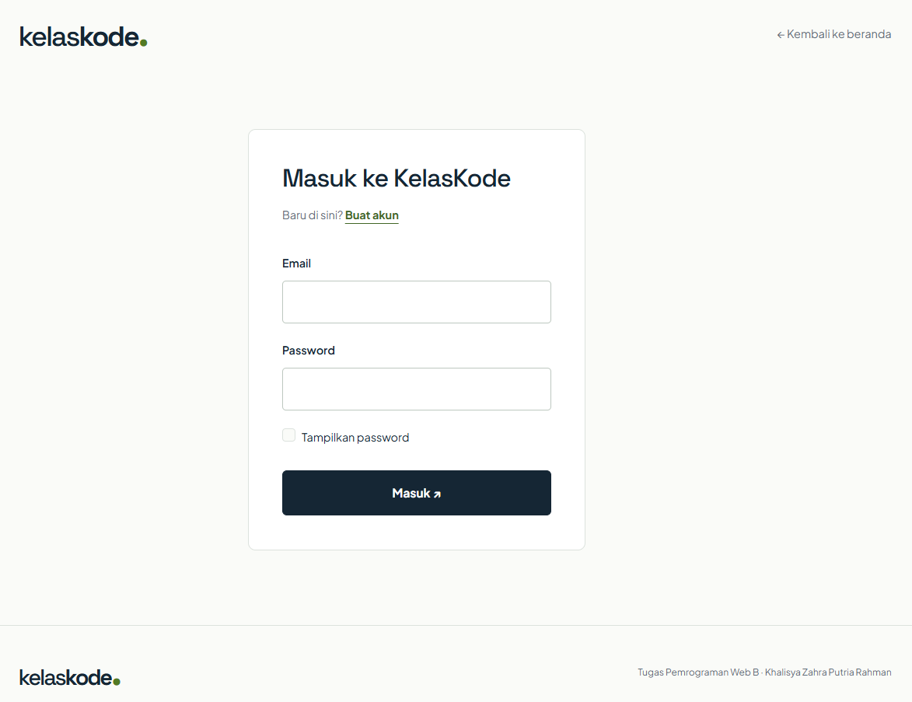
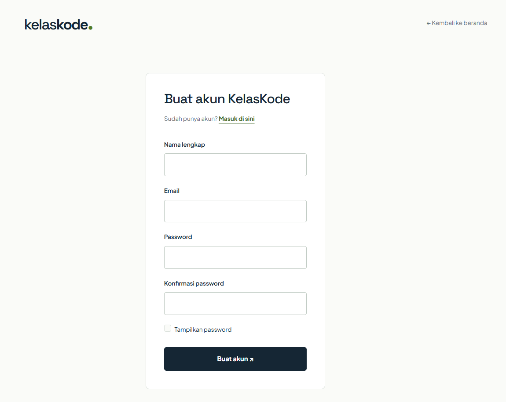

# Tugas 6 — Bootstrap Exercise

**Nama:** Khalisya Zahra Putria Rahman  

**NRP:** 5025251045

**Kelas:** Pemrograman Web B

## Deskripsi tugas

Tugas ini mempelajari penggunaan Bootstrap melalui tiga halaman: portal konten, login, dan registrasi. Setiap halaman dibuat sebagai dokumen HTML tersendiri yang memuat Bootstrap serta satu stylesheet bersama, yaitu `style.css`.

Selain menyelesaikan ketiga latihan tersebut, saya juga membuat **website implementasi bernama KelasKode** di folder `bootstrap-web-implement`. Website ini menerapkan konsep layout dan komponen Bootstrap ke dalam tema learning hub atau les programming.

## Penjelasan Bootstrap

Bootstrap adalah toolkit frontend yang menyediakan sistem layout, komponen antarmuka, dan utility class untuk menyusun website responsif. Penggunaannya membantu menjaga konsistensi ukuran, jarak, warna, tombol, kartu, dan form tanpa menulis seluruh gaya dari awal.

Proyek ini menggunakan file **Bootstrap 5.3.8** yang disimpan dalam folder `assets`. File CSS menyediakan gaya dan sistem grid, sedangkan JavaScript bundle menyediakan perilaku komponen interaktif Bootstrap seperti collapse, accordion, dan modal ketika komponen tersebut digunakan.

### Sistem grid

Grid Bootstrap membagi satu baris menjadi **12 kolom**. Struktur umumnya terdiri dari `container`, `row`, dan kelas kolom.

```html
<div class="container">
  <div class="row">
    <aside class="col-md-3">Sidebar</aside>
    <main class="col-md-9">Konten</main>
  </div>
</div>
```

Pada contoh tersebut, sidebar memakai 3 bagian dan konten memakai 9 bagian. Awalan `md` berarti pembagian tersebut diterapkan mulai lebar layar 768 piksel. Di bawah breakpoint itu, kedua area tersusun secara vertikal karena tidak diberi ukuran kolom yang lebih kecil.

### Komponen dan utility class

| Class                                 | Fungsi dalam latihan                          |
| ------------------------------------- | --------------------------------------------- |
| `container`                           | Membatasi lebar dan memusatkan area konten    |
| `container-fluid`                     | Menggunakan seluruh lebar area yang tersedia  |
| `row`, `col-md-*`, `col-lg-*`         | Membentuk susunan kolom responsif             |
| `card`, `card-body`, `card-title`     | Menyusun kartu informasi                      |
| `btn`, `btn-primary`, `btn-success`   | Mengatur bentuk dan variasi tombol            |
| `form-control`                        | Menyeragamkan tampilan input                  |
| `form-floating`                       | Menampilkan label mengambang pada input       |
| `form-check`, `form-check-input`      | Menyusun checkbox dan label                   |
| `d-flex`, `align-items-center`        | Mengatur layout flex dan perataan vertikal    |
| `d-none`, `d-md-flex`                 | Mengatur visibilitas berdasarkan ukuran layar |
| `p-3`, `py-5`, `mb-3`, `my-4`         | Mengatur padding dan margin                   |
| `bg-primary`, `bg-dark`, `text-white` | Memberikan warna latar dan teks               |
| `w-100`, `h-100`                      | Mengisi lebar atau tinggi ruang yang tersedia |

### Bootstrap dan CSS khusus

Ketiga halaman memuat Bootstrap terlebih dahulu, kemudian CSS khusus:

```html
<link rel="stylesheet" href="assets/bootstrap.min.css" />
<link rel="stylesheet" href="style.css" />
```

Urutan ini memungkinkan `style.css` menyesuaikan gaya Bootstrap sesuai kebutuhan, dengan tetap mengikuti aturan prioritas selector CSS. Ketiga HTML tidak harus saling terhubung agar dapat menggunakan stylesheet yang sama; masing-masing cukup memanggil file tersebut melalui elemen `link`.

## Struktur folder

```text
Tugas-6/
├── README.md
├── 1-portal.html
├── 2-login.html
├── 3-register.html
├── style.css
├── assets/
│   ├── bootstrap.min.css
│   ├── bootstrap.bundle.min.js
│   ├── BOOTSTRAP-LICENSE.txt
│   ├── learning.jpg
│   ├── space-grotesk.ttf
│   ├── SPACE-GROTESK-LICENSE.txt
│   ├── plus-jakarta-sans.ttf
│   └── PLUS-JAKARTA-LICENSE.txt
├── dokumentasi/
│   ├── portal.png
│   ├── login.png
│   └── register.png
└── bootstrap-web-implement/
    ├── index.html
    ├── 2-login.html
    ├── 3-register.html
    ├── style.css
    └── app.js
```

Folder `dokumentasi` menyimpan screenshot ketiga latihan. Folder `bootstrap-web-implement` menyimpan website pengembangan terpisah dengan stylesheet dan JavaScript sendiri. Aset Bootstrap, foto, dan font yang tersedia pada struktur proyek saat ini berada di `Tugas-6/assets`.

## Soal 1 — Halaman portal

### Deskripsi

[`1-portal.html`](1-portal.html) menerapkan layout halaman konten dengan **header, sidebar, konten utama, dan footer**. Fokus latihan adalah memahami pembagian area halaman menggunakan grid Bootstrap.

### Struktur halaman

| Area         | Isi dan penerapan                                                                             |
| ------------ | --------------------------------------------------------------------------------------------- |
| Header       | Judul Header dan navigasi Home, About, Contact; memakai `bg-primary`, `text-white`, dan `p-3` |
| Sidebar      | Tiga kartu menu; memakai `aside` dengan `col-md-3`                                            |
| Konten utama | Dua kartu fitur dan satu kartu artikel; memakai `main` dengan `col-md-9`                      |
| Kartu fitur  | Dua kolom `col-md-6` di dalam area konten                                                     |
| Footer       | Identitas halaman serta tautan Privacy, Terms, dan Support                                    |

Pembagian sidebar dan konten mengikuti rasio **3:9**. Dua fitur di dalam konten membagi satu baris menjadi **6:6**. Pada layar kecil, kolom tersebut tersusun ke bawah.

Kartu menggunakan `card` dan `card-body` untuk memisahkan wadah dari isinya. `h-100` membantu dua kartu fitur mengisi tinggi kolom masing-masing. Artikel berada di bawah kedua fitur dan menggunakan lebar area konten yang tersedia.

### Dokumentasi kode

```html
<aside class="col-md-3 mb-3">
  <!-- Kartu sidebar -->
</aside>

<main class="col-md-9">
  <div class="row">
    <div class="col-md-6 mb-3">
      <!-- Kartu fitur pertama -->
    </div>
    <div class="col-md-6 mb-3">
      <!-- Kartu fitur kedua -->
    </div>
  </div>
</main>
```

### Dokumentasi



## Soal 2 — Halaman login

### Deskripsi

[`2-login.html`](2-login.html) menampilkan form masuk dengan konsep **split layout**: foto di sisi kiri dan form di sisi kanan. Form berisi email, password, checkbox Remember password, tombol Sign in, dan tautan Forgot password.

### Dokumentasi kode

```html
<div class="row g-0">
  <div class="d-none d-md-flex col-md-4 col-lg-6 bg-image"></div>
  <div class="col-md-8 col-lg-6">
    <!-- Form login -->
  </div>
</div>
```

| Ukuran layar        | Pembagian area                                    |
| ------------------- | ------------------------------------------------- |
| Di bawah 768 piksel | Foto disembunyikan; area form mengisi lebar layar |
| Mulai 768 piksel    | Foto 4 kolom, form 8 kolom                        |
| Mulai 992 piksel    | Foto 6 kolom, form 6 kolom                        |

`g-0` menghilangkan gutter antarkolom sehingga foto dan area form saling berdampingan tanpa celah. Class `login` memiliki `min-height: 100vh`, sedangkan `d-flex align-items-center` menempatkan isi form di tengah secara vertikal ketika ruang tersedia.

### Screenshot



## Soal 3 — Halaman registrasi

### Deskripsi

[`3-register.html`](3-register.html) membuat form registrasi sesuai contoh tampilan: judul **Please Sign Up**, subjudul **It's free and always will be.**, dua garis warna, kolom identitas, persetujuan, serta tombol Register dan Sign In.

### Susunan form

| Bagian                        | Susunan                                                       |
| ----------------------------- | ------------------------------------------------------------- |
| First Name dan Last Name      | Dua kolom sejajar menggunakan `col-6`                         |
| Display Name                  | Satu kolom selebar form                                       |
| Email Address                 | Satu kolom selebar form                                       |
| Password dan Confirm Password | Dua kolom sejajar menggunakan `col-6`                         |
| Persetujuan                   | Checkbox I Agree dan teks Terms and Conditions                |
| Tombol                        | Register biru dan Sign In hijau, masing-masing setengah baris |

Class `col-6` menjaga pasangan input tetap berdampingan pada semua breakpoint. Berbeda dengan `col-md-6`, ukurannya tidak menunggu layar mencapai lebar `md`.

### Dokumentasi kode

```html
<div class="row signup-row">
  <div class="col-6">
    <input class="form-control" type="text" placeholder="First Name" />
  </div>
  <div class="col-6">
    <input class="form-control" type="text" placeholder="Last Name" />
  </div>
</div>
```

Garis warna dibuat melalui `linear-gradient()` dengan beberapa rentang warna berurutan. Susunan checkbox dan teks ketentuan memakai CSS Grid, sementara warna tombol menyesuaikan variabel Bootstrap pada `.btn-primary` dan `.btn-success`.

### Screenshot



## Website implementasi — KelasKode

Selain tiga halaman latihan, saya membuat website implementasi **KelasKode** yang berada dalam folder [bootstrap-web-implement](bootstrap-web-implement/). KelasKode mengambil tema learning hub programming, dengan katalog kelas Frontend, Backend, dan Python.

Website ini merupakan pengembangan dari materi Bootstrap menjadi antarmuka dengan identitas sendiri. Warna utama memakai biru tua, hijau limau, dan latar terang. Logo serta judul menggunakan **Space Grotesk**, sedangkan teks menggunakan **Plus Jakarta Sans**.

| File implementasi | Peran                                                                                |
| ----------------- | ------------------------------------------------------------------------------------ |
| `index.html`      | Halaman utama, sidebar, katalog kelas, FAQ, ajakan bergabung, dan modal detail kelas |
| `login.html`      | Tampilan login untuk tema KelasKode                                                  |
| `register.html`   | Tampilan registrasi untuk tema KelasKode                                             |
| `style.css`       | Identitas visual, font, warna section, dan penyesuaian responsif                     |
| `app.js`          | Logika filter kelas, pengisian modal, serta penanganan form implementasi             |

Komponen yang diterapkan mencakup grid, navbar collapse, list group untuk filter, card katalog, accordion FAQ, modal, form control, dan feedback validasi. Pada halaman utama, header berada di atas, sidebar di kiri, konten di kanan, serta footer di bawah. Pada layar kecil, sidebar tersusun di atas konten.

JavaScript pada folder implementasi merespons kategori melalui `data-filter`, menyembunyikan kartu yang tidak sesuai, dan memperbarui jumlah hasil. Penanganan modal memakai event Bootstrap `show.bs.modal`, sedangkan form implementasi memiliki penanganan validasi tersendiri. Fitur tersebut terpisah dari tiga halaman latihan di direktori utama yang berfokus pada reproduksi layout.

### Dokumentasi tampilan

- **Landing Page**
 

- **Login Page**
 

- **Sign in Page**


## Referensi dan kredit

- [Dokumentasi resmi Bootstrap 5.3](https://getbootstrap.com/docs/5.3/getting-started/introduction/) — grid, utility class, komponen, dan form.
- [Foto Marlborough Sounds saat senja di Unsplash](https://unsplash.com/id/foto/pemandangan-udara-marlborough-sounds-saat-senja-V1BUsf4PHZk) — gambar latar halaman login latihan.
- [Space Grotesk](https://github.com/google/fonts/tree/main/ofl/spacegrotesk) — font untuk identitas website implementasi.
- [Plus Jakarta Sans](https://github.com/google/fonts/tree/main/ofl/plusjakartasans) — font teks website implementasi.

Bootstrap menggunakan lisensi MIT. Kedua font menggunakan SIL Open Font License. Salinan lisensi disimpan di folder `assets`.
